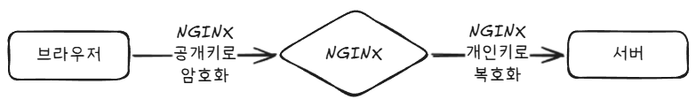
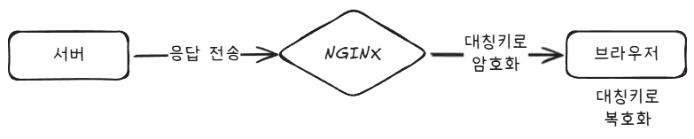
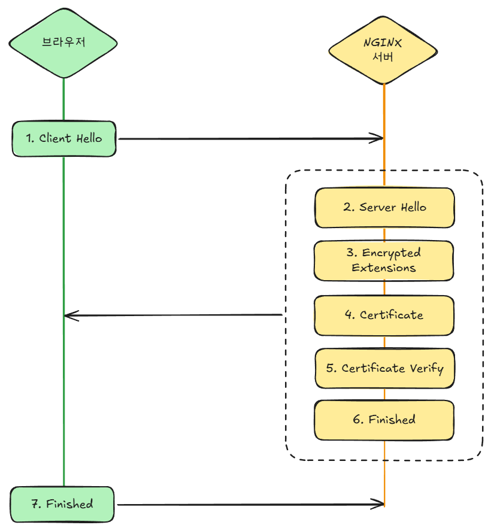
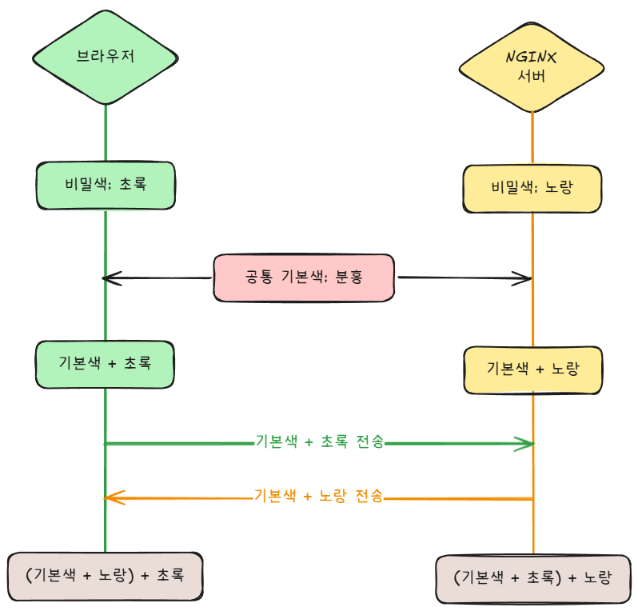

# 알아보게 된 계기

현장에 나가 NGINX 인증서를 패치하는 작업을 옆에서 보았다.  
나는 기존에 `.pem` 파일로 인증서와 개인키를 지정하는 방식을 사용했는데, 이번에 고객사에서 제공해준 인증서 파일은 `.pfx` 등이었고, 중간 인증서까지 이어 붙인 **풀체인(fullchain)**으로 세팅해야 했다.  
이런 방식은 이때 처음 보았다.  

NGINX는 `.pfx`를 바로 읽지 못하기 때문에, 먼저 `.pfx`에서 인증서와 개인키를 `.pem`으로 꺼내야 한다.  

```bash
# 서버 인증서
openssl pkcs12 -in cert.pfx -clcerts -nokeys -out server.crt
# 중간 인증서
openssl pkcs12 -in cert.pfx -cacerts -nokeys -out chain.crt
# 개인키
openssl pkcs12 -in cert.pfx -nocerts -nodes -out privkey.pem

# 서버 인증서 → 중간 인증서 순서로 이어 붙여 풀체인 생성
cat server.crt chain.crt > fullchain.pem
```

이렇게 만든 파일을 NGINX에 지정한다.  

```nginx
server {
    listen 443 ssl;

    ssl_certificate     /etc/nginx/ssl/fullchain.pem;  # 서버 인증서 + 중간 인증서
    ssl_certificate_key /etc/nginx/ssl/privkey.pem;    # 서버 개인키
}
```

돌아와서 풀체인 인증서 세팅 방법을 정리하다 보니 질문이 하나 생겼다.  
"NGINX는 이 인증서와 개인키로 어떻게 인증을 하는 걸까?"

# NGINX에서의 SSL 인증 과정

## 최초 Request

처음에 내가 생각한 요청 흐름은 아래와 같았다.  



브라우저가 NGINX의 공개키로 요청을 암호화해서 보내고, NGINX가 개인키로 복호화한 뒤 백엔드 서버로 넘긴다고 생각했다.  

NGINX가 TLS를 대신 처리하고(TLS termination) 백엔드 서버와는 평문으로 통신한다는 점은 맞다.  
하지만 알아보니 **요청을 공개키로 암호화하지는 않는다.**  
공개키 암호화는 느리기 때문에, 핸드셰이크에서 양쪽이 같은 **대칭키**를 만들어 두고 실제 요청과 응답은 그 대칭키로 암호화한다.  
NGINX의 개인키는 복호화가 아니라 "이 인증서의 주인이 정말 나다"라는 **서명**에 쓰인다.  

## Response



백엔드 서버가 NGINX에 평문으로 응답을 보내면, NGINX가 핸드셰이크에서 만든 대칭키로 암호화해 브라우저에 전달한다.  

브라우저는 같은 대칭키로 응답을 복호화한다.  

그렇다면 이 대칭키는 핸드셰이크의 어떤 과정에서, 어떻게 만들어지는 걸까?  

# TLS 1.3 Handshake

{: width="537" }

## 1. Client Hello: 추측하고 먼저 보내기

브라우저는 NGINX가 선택할 확률이 높은 [디피-헬먼](#디피-헬먼) 그룹을 미리 예측한다.  
그리고 **버전 정보와 그 그룹으로 만든 자신의 임시 키 공유값(key share)**을 첫 패킷에 함께 넣어 보낸다.  

TLS 1.2에서는 서로 쓸 방식을 먼저 조율하고 그다음에 키를 유도하느라 왕복이 2번 필요했다.  
TLS 1.3은 키 공유값을 먼저 던져서 이 왕복을 1번으로 줄였다.  
예측이 빗나가면 서버가 `HelloRetryRequest`로 다른 그룹을 요청하고, 그때는 왕복이 한 번 더 생긴다.  

## 2. Server Hello

NGINX는 버전과 Cipher Suite를 고른다.  
그리고 브라우저가 예측한 그룹에 맞춰 **자신의 키 공유값**을 보낸다.  

이 시점에서 양쪽은 상대의 키 공유값과 자신의 비밀 값을 모두 갖게 된다.  
즉, 첫 번째 왕복이 끝나기도 전에 양측 모두 대칭키를 완성한다.  
이후의 모든 패킷은 대칭키로 암호화된다.  

## 3~6. Encrypted Extensions ~ Finished

NGINX는 다음 메시지들을 하나로 묶어 브라우저에 보낸다.  
이미 대칭키가 있으므로 이 묶음은 전부 암호화되어 있다.  

- **Encrypted Extensions**: 암호화가 필요한 나머지 확장 정보  
- **Certificate**: 서버 인증서  
- **Certificate Verify**: 인증서가 진짜임을 증명하는 서명. 지금까지의 핸드셰이크 내용을 NGINX의 개인키로 서명한다.  
- **Finished**: 서버 측 핸드셰이크 종료  

처음에 봤던 풀체인이 쓰이는 곳이 바로 **Certificate** 메시지다.  
NGINX는 `ssl_certificate`에 지정된 파일의 인증서들을 이 메시지에 실어 보낸다.  
브라우저는 받은 인증서에서 시작해 자신이 신뢰하는 루트 인증서까지 체인을 이어 검증하는데, 중간 인증서가 빠져 있으면 이 체인이 끊길 수 있다.  
풀체인 파일로 세팅하는 이유가 여기에 있다.  

## 7. Finished

브라우저는 서버 인증서와 서명을 확인한다.  
문제가 없으면 핸드셰이크 종료를 알리는 **Finished** 패킷을 보낸다.  
이제부터 오가는 요청과 응답은 핸드셰이크에서 만든 대칭키로 암호화된다.  

이런 일련의 과정을 살펴보고 나는 또 궁금한 점이 생겼다.  
"키 공유값만 주고받았는데, 어떻게 양쪽이 같은 대칭키를 갖게 되지?"

# 디피-헬먼

TLS 1.3에서는 디피-헬먼 방식으로 대칭키를 만든다.  

## 예시: 물감 섞기

{: width="447" }

1. 공통 색을 공개한다: `분홍`
2. 각자 비밀색을 고른다.
   - 브라우저: `초록`
   - NGINX: `노랑`
3. 공통 색에 비밀색을 섞어서 교환한다.
   - 브라우저: `분홍 + 초록`을 NGINX에 전송
   - NGINX: `분홍 + 노랑`을 브라우저에 전송
4. 받은 색에 자신의 비밀색을 섞는다.
   - 브라우저: `(분홍 + 노랑) + 초록`
   - NGINX: `(분홍 + 초록) + 노랑`

결국 브라우저와 NGINX는 둘 다 `분홍 + 노랑 + 초록 = 갈색`을 갖게 되고, 이것이 최종 대칭키가 된다.  
중간에서 누군가 `분홍 + 초록`과 `분홍 + 노랑`을 엿보더라도, 섞인 물감에서 비밀색만 다시 분리해 내기는 어렵다.  

## 실제 수학적 원리

물감 섞기를 숫자로 바꾸면 다음과 같다.  

1. 공공 파라미터를 합의하고 공개한다.
   - 소수 `p = 23`, 생성원 `g = 5`
2. 각자 비밀 값(개인 키)을 정한다.
   - 클라이언트(A): `a = 4`
   - 서버(B): `b = 3`
3. 공개 값(혼합물)을 계산해 교환한다.
   - A: `g^a mod p = 5^4 mod 23 = 4` → B에게 `4` 전송
   - B: `g^b mod p = 5^3 mod 23 = 10` → A에게 `10` 전송
4. 받은 값으로 공통 대칭키를 계산한다.
   - A: `10^a mod p = 10^4 mod 23 = 18`
   - B: `4^b mod p = 4^3 mod 23 = 18`
   - 공통 대칭키는 `18`

두 값이 같은 이유는 양쪽 모두 결국 `g^(ab) mod p`를 계산하기 때문이다.  
A는 `(g^b)^a`를, B는 `(g^a)^b`를 계산했을 뿐이다.  

예시에서는 숫자가 작아서 `4`와 `10`만 보고도 `a`, `b`를 금방 찾을 수 있다.  
실제로는 아주 큰 수를 쓰기 때문에, 공개된 값만으로 `a`나 `b`를 무차별 대입으로 알아내기가 사실상 불가능하다.  
